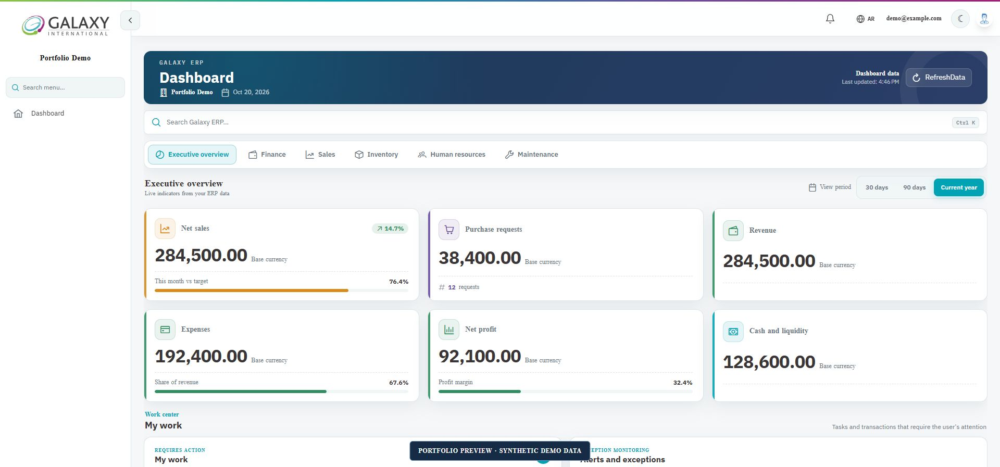
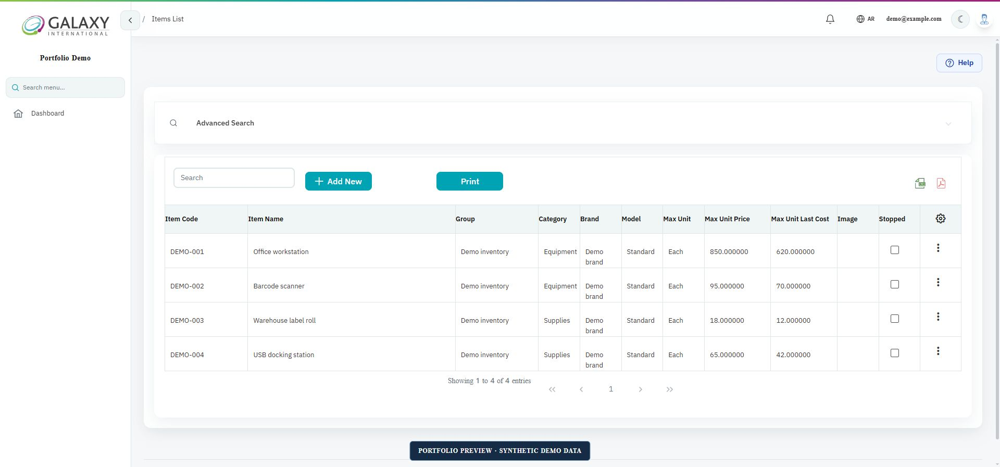
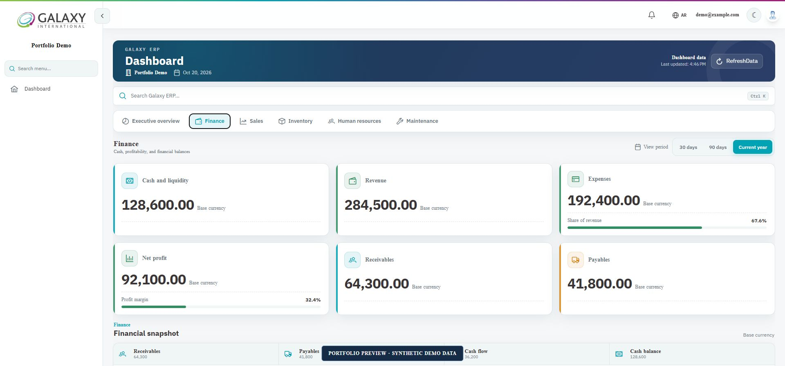
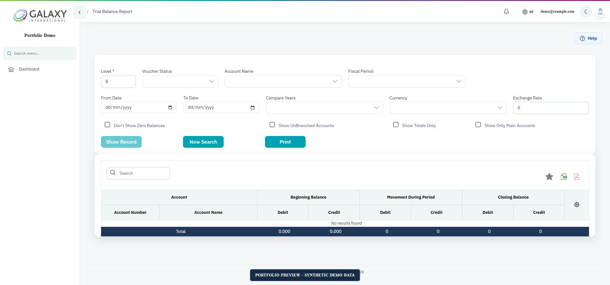
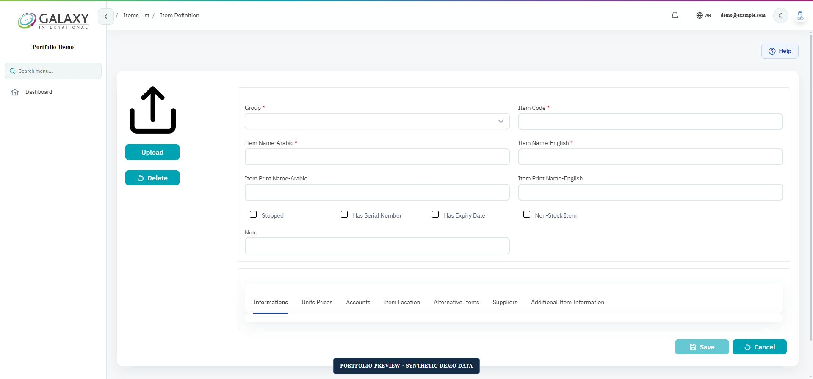
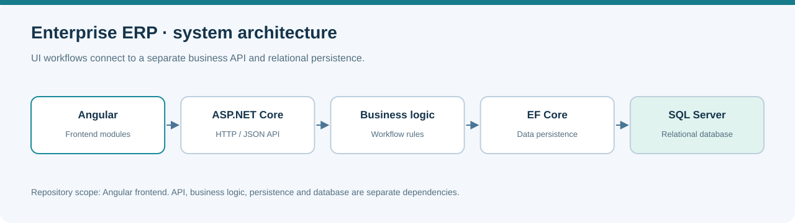

# Enterprise ERP System

**Angular · TypeScript · ASP.NET Core integration · SQL Server · Arabic / English**

An enterprise business application for connected operational workflows: inventory, accounting, purchasing, sales, receivables, payables, and reporting. This is my primary portfolio project for demonstrating the structure and complexity of real-world ERP development.

> **Repository scope:** this repository contains the Angular frontend. The ASP.NET Core backend and SQL Server database are separate dependencies and are not included here. The diagram below shows the wider system and marks that boundary.

## What it solves

ERP software brings transactions, master data, permissions, and reporting into a consistent application. This frontend organizes those workflows into business modules, with shared authentication, navigation, API communication, and bilingual presentation.

## Application preview

These screenshots show the current development interface using **synthetic demo data or empty states**. They are portfolio previews; some visual enhancements shown may be newer than this repository's frontend snapshot.

### Executive dashboard



### Inventory management



### Accounting and finance overview



### Trial balance reporting



### Business forms



## Key capabilities

| Area | Workflows represented in the frontend |
| --- | --- |
| Inventory | Items, item groups, stores, stock receipts/issues, transfers, reservations, adjustments |
| Accounting | Chart of accounts, journal vouchers, fiscal periods, budgets, financial reports |
| Sales and purchasing | Sales invoices, returns, purchase requests, purchase orders, supplier workflows |
| Receivables and payables | Customer/supplier balances, payment/receipt vouchers, debit/credit notes |
| Operations | Fixed assets, production, projects, CRM, maintenance, vehicle fleet modules |
| Reporting | Report lists, parameter forms, report viewing, reporting integrations |
| Shared application layer | Authentication, route guards, API services, Arabic/English translations |

Data and operations depend on the connected backend, company configuration, and user permissions.

## Architecture



```text
src/
  app/
    shared/                 Layouts, guards, services, shared UI
    views/
      dashboard/            Summary screens
      app-inventory/        Items and stock workflows
      app-account/          Accounting and journal workflows
      app-sales/            Sales workflows
      app-purchase/         Purchasing workflows
      app-receivables/      Customer balances and documents
      app-payables/         Supplier balances and documents
      app-reports/          Report selection and viewing
  assets/i18n/              Translation resources
  environments/            Angular environment configuration
  config.ts                API base URL and roles
```

## Technologies

The public frontend snapshot declares **Angular 18**, TypeScript 5.4, RxJS, Angular Material, PrimeNG, DevExtreme, ngx-translate, Chart.js/ApexCharts/ECharts, and DevExpress reporting integrations. See [package.json](package.json) for dependencies and scripts.

## Run locally

Prerequisites: Node.js/npm compatible with the declared Angular 18 toolchain, a compatible ERP ASP.NET Core backend with an initialized SQL Server database, and a company/user configured in that backend.

```bash
git clone https://github.com/HamzaDee/fullstack-angular-dotnet-ERP-System.git
cd fullstack-angular-dotnet-ERP-System
npm ci
```

Set `apiURL_Main` in `src/config.ts` to your local ERP backend, for example:

```typescript
apiURL_Main: "http://localhost:7209"
```

```bash
npm start
```

Open **http://localhost:4200/Account/Login** and sign in with a user configured in your own backend. This repository does not provide a universal demo login or database seed. Without the separate backend, authenticated screens cannot retrieve business data. Configure the backend's allowed frontend origin as needed.

```bash
npm run build        # Production frontend build
npm test             # Configured Karma runner
```

Commercial UI/reporting components may require vendor licensing for your usage.

## API integration examples

These routes are called by the checked-in Angular services. They document the **integration contract**; their server implementations are outside this repository.

| Method | Route | Use |
| --- | --- | --- |
| `GET` | `/api/MainDashbored/GetAllTodayVoucher/{lang}/{companyId}/{userId}` | Dashboard document summary |
| `GET` | `/api/Items/ItemsList/{lang}/{companyId}/{userId}` | Inventory item list |
| `POST` | `/api/Items/PostItemForm/{userId}/{companyId}` | Submit item form |
| `GET` | `/api/EntryVouchers/EntryVouchersList/{lang}/{companyId}/{userId}` | Journal voucher list |
| `POST` | `/api/EntryVouchers/SaveEntryVoucher/{companyId}/{userId}` | Submit journal voucher |

Parameter order follows the existing services. Company/user context comes from the authentication service; the backend must enforce access independently of the UI.

## Architecture decisions

| Decision | Purpose and tradeoff |
| --- | --- |
| Modules grouped by business domain | Keep related ERP workflows navigable as the system grows. |
| Lazy-loaded routes | Load feature areas through the router rather than the root module. |
| Shared API services | Separate communication/context handling from screen templates. |
| Arabic and English resources | Support localized workflows and RTL/LTR presentation. |
| Enterprise UI/reporting libraries | Support complex grids/forms/reports with library and licensing dependencies. |
| Separate frontend/backend delivery | Allow independent delivery while requiring coordinated API/database setup. |

## Engineering experience represented

This project reflects my focus on translating enterprise requirements into modules and forms, integrating Angular with backend APIs, and supporting accounting and inventory workflows across a large application.

---

[Hamza Naghnaghieh](https://github.com/HamzaDee) · **Full-Stack Software Engineer | 7 years**
